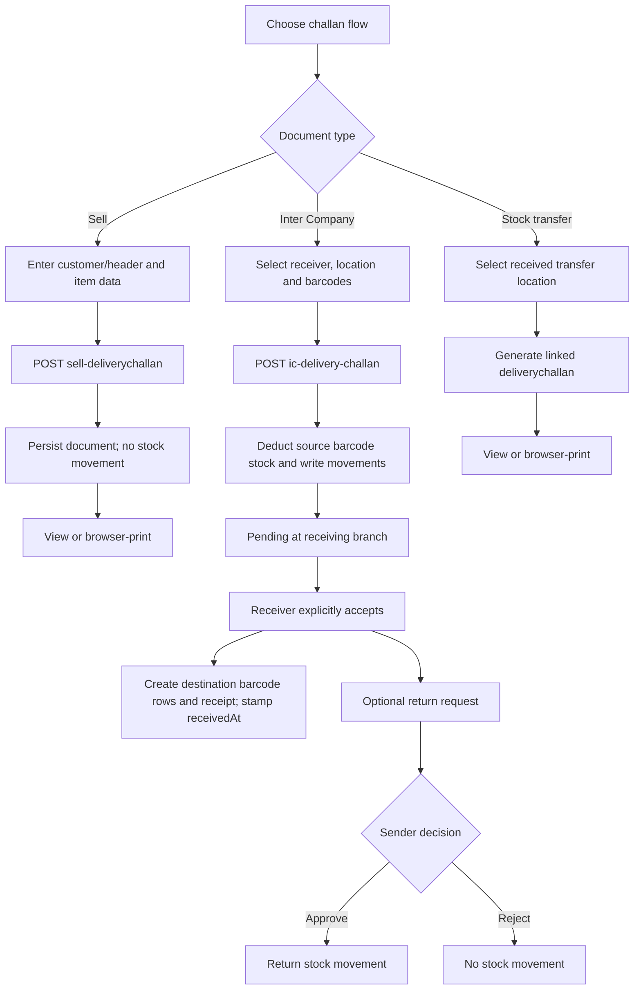
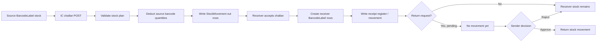
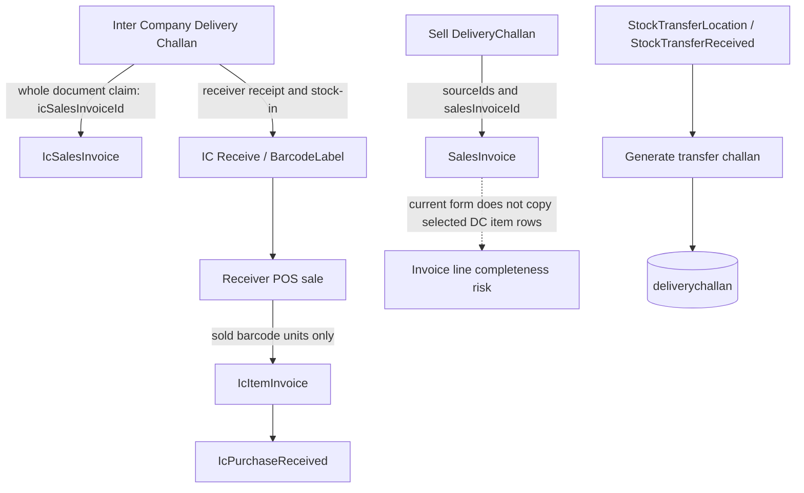

# Delivery Challan Module — Technical and Functional Guide

> **Scope and accuracy.** The repository contains three different document flows called “Delivery Challan”: customer-facing Sell Challans, Inter Company Challans, and challans generated from location stock transfers. They do not share one lifecycle or stock implementation. This document distinguishes observed behavior from issues and recommendations. “NOT VERIFIED” means it could not be established from the checked source; it is not an assertion that the feature is absent everywhere.

## 1. Module Overview

| Flow | Main page(s) | Model / collection | Purpose |
|---|---|---|---|
| Sell Delivery Challan | [`app/admin/transaction/sell/deliverychallan/`](./app/admin/transaction/sell/deliverychallan/) | [`models/DeliveryChallan.js`](./models/DeliveryChallan.js) / `deliverychallan` | Customer-facing challan form, listing and print view. Its create/update API does not move stock. |
| Inter Company Delivery Challan | [`app/admin/transaction/intercompanysell/deliverychallan/`](./app/admin/transaction/intercompanysell/deliverychallan/) and [`receivedeliverychallan/page.jsx`](./app/admin/transaction/intercompanysell/receivedeliverychallan/page.jsx) | [`models/IcDeliveryChallan.js`](./models/IcDeliveryChallan.js) / `icdeliverychallan` | Sends barcode-level stock from one business to another, then records destination receipt and return requests. |
| Stock-transfer-generated challan | [`app/admin/transaction/stocktransfers/transferstockreceiveds/page.jsx`](./app/admin/transaction/stocktransfers/transferstockreceiveds/page.jsx) and [`delivery-challan/[id]/page.jsx`](./app/admin/transaction/stocktransfers/delivery-challan/[id]/page.jsx) | [`models/DeliveryChallan.js`](./models/DeliveryChallan.js) / `deliverychallan` | Creates a printable document from stock-transfer location/receipt records. It is not the Sell or Inter Company stock-out operation. |

The shared Sell/transfer model is a Mongoose model named `deliveryChallan` with its collection explicitly pinned to lowercase `deliverychallan`. Inter Company uses a separate model and collection. `models/Delivery.js` is the Delivery/LR freight transaction and is not the Delivery Challan model.

## 2. Business Purpose

- **Sell Challan:** records a goods dispatch document addressed to a customer. The present save path persists the header and submitted `items`; it does not decrement stock.
- **Inter Company Challan:** records goods sent between businesses. Creating it deducts barcode-level stock at the sending branch. The receiving branch separately accepts it, which creates destination barcode stock.
- **Transfer Challan:** prints a document derived from a stock-transfer receipt/location record. The transfer and receipt logic is elsewhere; generating the document itself copies transfer data into `deliverychallan`.

These are operationally distinct even though two use the same print component/model. Do not infer stock, invoice, or status behavior for one flow from another.

## 3. Complete Business Workflow

### Sell Delivery Challan

1. Select the Sell Delivery Challan screen and enter business/location/financial-year scope through the shared transaction UI.
2. Enter customer, customer GSTN, date and any other configured header values.
3. Use the configured item scan/search or submit the available form data.
4. The API validates the configured header fields, assigns a document number when absent, and saves the document. No stock movement is performed by this route.
5. View the record in the list, open its detail page, or print it.
6. A separate Sell Sales Invoice path can select challan source IDs and stamp `salesInvoiceId`, but the current generic source selector does not populate invoice item lines (see [Related Document Integration](#16-related-module-integrations)).

### Inter Company Delivery Challan

1. The source branch selects a destination business and location, a source stock point, date and barcode lines.
2. The item lookup returns barcode-level stock and enriches a line with item, HSN, tax, UOM and rate data. The form calculates line and document totals.
3. POST validates the configured header, rejects sending to the same business, generates a DC number, and calls the stock shipping logic.
4. The shipping logic deducts source barcode quantities and writes `StockMovement` records. The API returns `received: false`; receipt is not automatic.
5. The destination branch reviews the pending challan and explicitly receives it. The receive route creates destination barcode rows and a receipt/stock record, then stamps `receivedAt` and `receivedBy`.
6. For damaged goods, the receiver may request a partial return. Stock changes only after the sender approves the request; rejection moves no stock.
7. Inter Company billing has two separate implementations: a whole-challan invoice flow and a newer receiver-sold-unit consignment invoice flow. They should not be treated as interchangeable.

### Stock Transfer Challan

1. The stock-transfer receipt/location workflow produces source rows.
2. A user generates a Delivery Challan for a `stockTransferLocationId`; the API copies its line data and links the challan to transfer/receipt IDs.
3. The detail endpoint returns the generated document and labels for printing.
4. The challan-generation endpoint does not itself execute the stock-transfer movement.

### Workflow diagram



## 4. Delivery Challan Lifecycle

### Sell and stock-transfer-generated documents

`DeliveryChallan.status` defaults to `"generated"`. The inspected Sell and transfer challan routes do not implement a richer state machine. Sell invoice conversion is represented separately by `salesInvoiceId`; stock-transfer linkage is represented by transfer IDs and `sourceDocNo`.

### Inter Company documents

There is no `status` field on `IcDeliveryChallan`. The practical receipt state is `receivedAt`:

- `receivedAt` null: awaiting receipt.
- `receivedAt` set: receiver accepted.
- `returnRequests[].status`: `pending`, `approved`, or `rejected`.
- `returns`: records completed return quantities.
- `icSalesInvoiceId`: whole-challan invoice association for the older invoicing path.

```mermaid
stateDiagram-v2
  [*] --> Sent: challan saved and source stock shipped
  Sent --> Received: receiver accepts / receivedAt set
  Sent --> Sent: receiver requests return
  Received --> ReturnPending: partial return request
  ReturnPending --> Returned: sender approves and stock moves
  ReturnPending --> Received: sender rejects; no stock moves
  Sent --> WholeChallanInvoiced: legacy invoice claims challan
  Received --> ConsignmentUnitsBilled: receiver-sold barcode units invoiced
```



The last two states are not mutually exclusive in the current data model: the consignment flow stamps barcode rows, not `icSalesInvoiceId`. See the identified risk below.

## 5. Frontend Architecture

### Sell

- Listing: [`app/admin/transaction/sell/deliverychallan/page.jsx`](./app/admin/transaction/sell/deliverychallan/page.jsx)
- Add/edit form configuration: [`app/admin/transaction/sell/deliverychallan/form.js`](./app/admin/transaction/sell/deliverychallan/form.js)
- Add/edit/detail routes: [`add/page.jsx`](./app/admin/transaction/sell/deliverychallan/add/page.jsx), [`[id]/page.jsx`](./app/admin/transaction/sell/deliverychallan/%5Bid%5D/page.jsx), [`[id]/challan/page.jsx`](./app/admin/transaction/sell/deliverychallan/%5Bid%5D/challan/page.jsx)
- Shared form and list behavior: [`components/TransactionFormView.jsx`](./components/TransactionFormView.jsx), [`components/ListView.jsx`](./components/ListView.jsx)
- Print composition: [`components/SellChallanView.jsx`](./components/SellChallanView.jsx), [`components/ChallanDocument.jsx`](./components/ChallanDocument.jsx), line grouping/totals in [`lib/challan.js`](./lib/challan.js)

The generic form's configured scan looks up item records and appends item-code/name rows. The inspected path does not add a barcode stock allocation or populate the other configured commercial columns from that scan. The Sell form's item grid has no demonstrated complete line-edit/calculation workflow.

### Inter Company

- Outgoing list/add/edit: [`app/admin/transaction/intercompanysell/deliverychallan/page.jsx`](./app/admin/transaction/intercompanysell/deliverychallan/page.jsx), [`add/page.jsx`](./app/admin/transaction/intercompanysell/deliverychallan/add/page.jsx), [`[id]/page.jsx`](./app/admin/transaction/intercompanysell/deliverychallan/%5Bid%5D/page.jsx)
- Form and calculation rules: [`components/IcChallanForm.jsx`](./components/IcChallanForm.jsx), [`app/admin/transaction/intercompanysell/deliverychallan/fields.js`](./app/admin/transaction/intercompanysell/deliverychallan/fields.js)
- Receiving list/actions: [`app/admin/transaction/intercompanysell/receivedeliverychallan/page.jsx`](./app/admin/transaction/intercompanysell/receivedeliverychallan/page.jsx), [`components/IcInboxView.jsx`](./components/IcInboxView.jsx)
- Return request/review: [`app/admin/transaction/intercompanysell/consignment/page.jsx`](./app/admin/transaction/intercompanysell/consignment/page.jsx)
- Print: [`app/admin/transaction/intercompanysell/deliverychallan/print/[id]/page.jsx`](./app/admin/transaction/intercompanysell/deliverychallan/print/%5Bid%5D/page.jsx), [`components/IcChallanPrintView.jsx`](./components/IcChallanPrintView.jsx)

The IC form blocks duplicate barcode lines in the UI and exposes stock availability from lookup. The server-side stock engine is the actual stock authority.

### Stock transfer

- Source/list: [`components/StockTransferPacketList.jsx`](./components/StockTransferPacketList.jsx), [`app/admin/transaction/stocktransfers/transferstockreceiveds/page.jsx`](./app/admin/transaction/stocktransfers/transferstockreceiveds/page.jsx)
- Challan view: [`app/admin/transaction/stocktransfers/delivery-challan/[id]/page.jsx`](./app/admin/transaction/stocktransfers/delivery-challan/%5Bid%5D/page.jsx)
- Shared print component: [`components/ChallanDocument.jsx`](./components/ChallanDocument.jsx) is used for Sell and transfer challan layouts; the transfer detail page also contains its own table-based print markup.

## 6. Backend Architecture

Routes are Next.js App Router route handlers. Each route connects through [`lib/db.js`](./lib/db.js), uses `requireSession` from [`lib/session.js`](./lib/session.js), and returns JSON. Sell and IC routes use [`lib/screenPermission.js`](./lib/screenPermission.js) for screen-level access decisions. The transfer-generated challan route checks for a session, but no equivalent granular screen/business permission check was found in that handler.

Important shared code:

- [`lib/icStock.js`](./lib/icStock.js): plans/executes outgoing Inter Company stock movement.
- [`lib/icReceive.js`](./lib/icReceive.js): destination receipt and return stock operations.
- [`lib/barcodeLabel.js`](./lib/barcodeLabel.js): barcode-label model/collection used by IC stock.
- [`models/StockMovement.js`](./models/StockMovement.js): stock movement audit model.
- [`lib/docnumber.js`](./lib/docnumber.js): document number allocation helpers.
- [`lib/validate.js`](./lib/validate.js): field-based validation and regular-expression escaping.
- [`lib/refLabels.js`](./lib/refLabels.js): resolves reference labels for list/detail responses.

No MongoDB transaction/session wrapping was found around the complete IC send/receive multi-document workflows. Their ordering and compensating actions therefore matter (see [Known Issues and Bugs](#21-known-issues-and-bugs)).

### Frontend-to-backend diagram

```mermaid
flowchart LR
  subgraph UI[Next.js admin pages]
    SellUI[Sell challan pages and TransactionFormView]
    IcUI[IcChallanForm and receiving/return screens]
    TransferUI[Stock transfer packet and challan pages]
  end
  subgraph API[App Router APIs]
    SellAPI[/api/sell-deliverychallan]
    IcAPI[/api/ic-delivery-challan]
    ReceiveAPI[/api/ic-receive-delivery-challan]
    TransferAPI[/api/stock-transfer-delivery-challan]
    DetailAPI[/api/delivery-challan/id]
  end
  subgraph DB[MongoDB collections]
    SellCol[(deliverychallan)]
    IcCol[(icdeliverychallan)]
    Barcodes[(BarcodeLabel)]
    Moves[(stockmovement)]
    TransferCol[(stocktransferlocation / stocktransferreceived)]
  end
  SellUI --> SellAPI --> SellCol
  IcUI --> IcAPI --> IcCol
  IcAPI --> Barcodes
  IcAPI --> Moves
  IcUI --> ReceiveAPI --> IcCol
  ReceiveAPI --> Barcodes
  ReceiveAPI --> Moves
  TransferUI --> TransferAPI --> TransferCol
  TransferAPI --> SellCol
  TransferUI --> DetailAPI --> SellCol
```

## 7. API Documentation

All endpoints below are implemented in the repository. Requests are JSON unless query parameters are shown. Session-protected routes return `401` when no session is available. Exact response details can vary by validation/error branch.

### Sell Delivery Challan

| Endpoint | Method | Purpose and request | Response/notes |
|---|---|---|---|
| `/api/sell-deliverychallan` | `GET` | List; query supports business, location, financial year, customer, date range, search, pagination/sort and an `unconverted` selector. | `{ rows, labels, total, page, pages, perPage }`; list uses reference-label resolution. |
| `/api/sell-deliverychallan` | `POST` | Create; `body.data` contains configured form fields and optional `items`; scope may be supplied as business/location/financial year. | Validates configured fields, generates document number if needed, stores the document. Does not move stock. |
| `/api/sell-deliverychallan/[id]` | `GET` | Read one by document ID. | `{ doc, labels }`, or not found. |
| `/api/sell-deliverychallan/[id]` | `PUT` | Update; `body.data` contains editable values. | Validates and updates. No guard was found for a document already linked to an invoice. |
| `/api/sell-deliverychallan/[id]` | `DELETE` | Delete by ID. | API exists; the listing UI does not expose a Delete action. No linked-invoice guard was found. |

### Inter Company Delivery Challan and receipt

| Endpoint | Method | Purpose and request | Response/notes |
|---|---|---|---|
| `/api/ic-delivery-challan` | `GET` | List by source/destination business/location, FY, date, search, paging and optional unconverted filter. | Includes rows/labels and list metadata; barcode-level display data are resolved for the UI. |
| `/api/ic-delivery-challan` | `POST` | Create; body contains destination IDs, date, stock point, optional header fields and `items` with barcode/qty data. | Generates `dcNo`, ships source stock, saves challan; response indicates `received: false`. |
| `/api/ic-delivery-challan/[id]` | `GET` | Read one challan. | `{ doc, labels }` and resolved references as implemented by the route. |
| `/api/ic-delivery-challan/[id]` | `PUT` | Update header/lines. | Rejects an already whole-challan-invoiced document; receipt/stock reconciliation is not otherwise enforced. |
| `/api/ic-delivery-challan/[id]` | `DELETE` | Delete by ID. | Rejects an already whole-challan-invoiced document; no compensating source-stock restoration was found for an already shipped challan. |
| `/api/ic-delivery-challan/item-codes` | `GET` | Item-code suggestions for business/location scope. | Bounded suggestions for the IC form. |
| `/api/ic-delivery-challan/item-lookup` | `GET` | Barcode/item lookup with business/stock scope. | Returns stock-eligible barcode and item/HSN/tax/UOM/rate data used by the form. |
| `/api/ic-receive-delivery-challan` | `GET` | Receiver-side pending/received challans and related display data. | Used by Receive Delivery Challan screen. |
| `/api/ic-receive-delivery-challan` | `POST` | Receiver action: accept challan, request return, or sender approve/reject return; payload contains challan and line/action data. | On acceptance, creates receipt barcode rows/register entries and stamps receipt. Return stock moves on approval only. |

### Stock-transfer-generated Delivery Challan

| Endpoint | Method | Purpose and request | Response/notes |
|---|---|---|---|
| `/api/stock-transfer-delivery-challan` | `GET` | List/source lookup for transfer challans. | Authenticated by session in the inspected route. |
| `/api/stock-transfer-delivery-challan` | `POST` | Generate from a stock-transfer location/receipt, including `stockTransferLocationId`. | Copies transfer items and creates a `deliverychallan`; it does not perform the underlying stock transfer. |
| `/api/delivery-challan/[id]` | `GET` | Fetch a generated challan and location labels for the transfer detail screen. | Returns `challan` and labels. |

### Related invoice/receipt endpoints

| Endpoint | Method | Relationship |
|---|---|---|
| `/api/sell-salesinvoice` | `GET` / `POST` | Sell invoice source selection and `salesInvoiceId` stamping. Current source selection does not populate invoice item rows. |
| `/api/ic-sales-invoice` | `GET` / `POST` | Older whole-challan Inter Company invoice; copies challan lines and claims each challan by `icSalesInvoiceId`. |
| `/api/ic-sales-invoice/[id]` | `GET` / `DELETE` | Reads/deletes old-style invoice; deletion releases challans unless already received. No `PUT` exists. |
| `/api/ic-item-invoice` | `GET` / `POST` | Newer consignment invoice; groups receiver-sold barcode rows by receiver and claims individual rows/sales. |
| `/api/ic-purchase-received` | `GET` / `POST` | Newer invoice receipt register (`IcPurchaseReceived`) for the consignment invoice flow. |
| `/api/ic-auto-purchase-received` | `GET` / `POST` | Separate older whole-invoice/GRC receipt flow. |

The exact query/body validation is defined in each route and its `FIELDS` module; callers should use the existing form/API pair rather than construct undocumented payloads.

## 8. Database Schema and Relationships

### Sell and transfer shared `deliverychallan` schema

Model: [`models/DeliveryChallan.js`](./models/DeliveryChallan.js). Mongoose model `deliveryChallan`; collection `deliverychallan`; timestamps enabled. The schema does not declare `fromLocationId` or `toLocationId`.

| Field | Type | Default | Required / reference / notes |
|---|---|---:|---|
| `businessId` | ObjectId | `null` | Indexed; ref `business`. |
| `locationId` | ObjectId | `null` | Indexed; ref `companyLocation`. |
| `finYear` | String | `''` | Indexed. |
| `customerId` | ObjectId | `null` | Ref `customer`. |
| `customerGstn`, `customerAddress` | String | `''` | Header snapshots/text. |
| `dcDate` | Date | `null` | Form requires it in Sell configuration. |
| `stockPointId` | ObjectId | `null` | Ref `stockPoint`. |
| `logisticId` | ObjectId | `null` | Ref `logistic`. |
| `salesTerm` | String | `''` | Form selection; calculation effect is not implemented in the inspected challan route. |
| `salesGroupId` | ObjectId | `null` | Ref `purchaseGroup`. |
| `salesPersonId`, `agentId` | ObjectId | `null` | Ref `agent` in this schema. |
| `salesLedgerId` | ObjectId | `null` | Ref `ledger`. |
| `customerWaybill` | String | `''` | Form file-style field; stored field is a string. Upload persistence details are NOT VERIFIED. |
| `taxableValue`, `roundOff`, `netValue` | Number | `null` | Totals. |
| `discountPercent`, `roundOffDiscountAmt` | Number | `0` | Totals/discount metadata. |
| `deliveryChallanNo` | String | `''` | Sell/transfer document number. |
| `stockTransferLocationId` | ObjectId | `null` | Indexed; ref `stockTransferLocation`. |
| `stockTransferReceivedId` | ObjectId | `null` | Indexed; ref `stockTransferReceived`. |
| `sourceDocNo` | String | `''` | Transfer source document number. |
| `totalQty`, `totalAmount` | Number | `0` | Transfer/detail totals; Sell create route does not derive these from line items. |
| `status` | String | `'generated'` | No complete status transition system found for Sell/transfer flows. |
| `customerMobile` | String | `''` | Schema field; not present in the inspected Sell form configuration. |
| `salesInvoiceId` | ObjectId | `null` | Indexed; downstream Sell invoice association. |
| `items` | Mixed | `[]` | Free-form lines; no Mongoose line-level validation. |
| `createdAt`, `updatedAt` | Date | Mongoose-managed | Timestamps. |

The model declares defaults but no `required: true` constraints on the above business fields. Required fields in the Sell flow are principally enforced through route/form validation.

### Inter Company `icdeliverychallan` schema

Model: [`models/IcDeliveryChallan.js`](./models/IcDeliveryChallan.js). Mongoose model `icDeliveryChallan`; collection `icdeliverychallan`; timestamps enabled.

| Field | Type | Default | Required / reference / notes |
|---|---|---:|---|
| `businessId` | ObjectId | `null` | Indexed; source ref `business`. |
| `locationId` | ObjectId | `null` | Indexed; source ref `companyLocation`. |
| `finYear` | String | `''` | Indexed. |
| `toBusinessId` | ObjectId | `null` | Indexed; destination ref `business`. |
| `toLocationId` | ObjectId | `null` | Destination ref `companyLocation`. |
| `customerGstn`, `customerAddress` | String | `''` | Destination business snapshot at save. |
| `dcNo` | String | `''` | Indexed; Inter Company DC number. |
| `dcDate` | Date | `null` | Form/API required. |
| `stockPointId` | ObjectId | `null` | Ref `stockPoint`; form/API required. |
| `agentId`, `salesPersonId` | ObjectId | `null` | Ref `contact`. |
| `salesTerm` | String | `''` | Header metadata. |
| `logisticId` | ObjectId | `null` | Ref `logistic`. |
| `customerWaybill` | String | `''` | Header metadata. |
| `taxableValue`, `igstTotal`, `cgstTotal`, `sgstTotal`, `roundOff`, `totalQty`, `netValue` | Number | `0` | Computed by form/server and stored for list/invoice use. |
| `discountPercent`, `roundOffDiscountAmt` | Number | `0` | Discount metadata. |
| `receivedAt` | Date | `null` | Indexed; receipt state marker. |
| `receivedBy` | String | `''` | Receiver identity text. |
| `returns`, `returnRequests` | Mixed | `[]` | Embedded return history and approvals. |
| `icSalesInvoiceId` | ObjectId | `null` | Indexed; whole-challan invoice flow. |
| `items` | Mixed | `[]` | Barcode-level lines; no strict Mongoose line schema. |
| `createdAt`, `updatedAt` | Date | Mongoose-managed | Timestamps. |

`businessId`/`locationId` are the sender scope. `toBusinessId`/`toLocationId` are the receiving scope.

### Important relationship collections

| Collection/model | Relationship |
|---|---|
| `deliverychallan` | Sell and transfer-generated challan documents; `salesInvoiceId` may link to Sell Sales Invoice; transfer IDs link to `stocktransferlocation` and `stocktransferreceived`. |
| `icdeliverychallan` | Inter Company header and embedded `items`; links source/destination businesses/locations and optionally `icSalesInvoiceId`. |
| BarcodeLabel collection | Barcode stock rows; IC destination rows retain originating challan identifiers (`icChallanId`/number) and billed markers. |
| `stockmovement` | Source-out, receipt, and approved-return audit entries; IC movement references the challan. |
| `stocktransferlocation`, `stocktransferreceived` | Transfer source/receipt documents from which a transfer challan is generated. |
| `icsalesinvoice` | Older whole-challan invoice; references `icDeliveryChallanIds`. |
| `iciteminvoice` | Newer consignment invoice; lines represent sold barcode quantities and carry challan linkage. |
| `icpurchasereceived` | Newer invoice-receipt record associated with `icItemInvoiceId`. |
| Business, CompanyLocation, StockPoint, Customer, Item, HSN, Tax, Contact/Agent, Logistic, Ledger | Master/reference data resolved by routes, forms, lookup endpoints or label helpers. |

Reference labels in list/detail views are generally resolved with `resolveRefLabels`; direct Mongoose `populate()` is not the universal pattern. No MongoDB transaction was found for the full IC stock/document workflow. Aggregation pipeline use in the challan routes was not identified; do not assume one.

## 9. Field-by-Field Documentation

### Sell form fields

The field definitions are in [`app/admin/transaction/sell/deliverychallan/form.js`](./app/admin/transaction/sell/deliverychallan/form.js). The configured header includes business/location and financial-year scope, customer, customer GSTN, challan date, stock point, logistics, sales term, sales group, salesperson, sales ledger/agent and customer waybill. The form marks `customerId`, `customerGstn`, and `dcDate` required; the model itself does not declare those fields required. GSTN is configured read-only. The inspected generic form does not reliably derive GSTN/address from the chosen customer, so blank customer GSTN can block save.

The configured line grid contains item code/name and commercial/tax columns such as HSN, GST slab, UOM, quantity, rate/discount and totals. The item scan/search implementation only demonstrated adding item code and name. Do not treat all configured columns as fully wired calculations or persisted totals.

### Inter Company fields and lines

The header fields and validation live in [`app/admin/transaction/intercompanysell/deliverychallan/fields.js`](./app/admin/transaction/intercompanysell/deliverychallan/fields.js). The form requires receiver business, receiver location, DC date and source stock point. Lines are selected by barcode and include item identity, HSN/tax, UOM, quantity, unit rate/discount, and computed taxable/GST/net amounts. Server stock movement uses barcode/quantity and validates available source stock; client-supplied display/calculation fields are not a substitute for server stock checks.

Line-level exact stored keys are free-form (`items` is Mixed); callers should inspect the form/route when changing them. The challan lookup/print paths use barcode, item, HSN, UOM, quantity and narrative fields. Mongoose does not enforce a fixed line shape.

## 10. Stock and Inventory Logic

| Flow | Stock effect at challan creation | Later stock effect |
|---|---|---|
| Sell | None in `/api/sell-deliverychallan` create/update. | Not found in the Sell challan route. Sales invoice/dispatch effects are separate and must not be assumed from the challan. |
| Inter Company | `shipChallanStock` in [`lib/icStock.js`](./lib/icStock.js) deducts source barcode quantities and writes `StockMovement` rows. | Receiver acceptance through [`lib/icReceive.js`](./lib/icReceive.js) creates destination barcode rows/receipt records. Approved returns move stock back; pending/rejected requests do not. |
| Stock transfer generated DC | No stock movement in the DC-generation route itself. | Stock transfer movement is performed by the separate stock-transfer workflow; the generated document copies transfer quantities. |

The IC form shows barcode stock by source business/stock context, blocks duplicate barcode lines in the UI, and derives quantities/UOM from barcode/item information. The stock point is captured on the challan. Aggregate reservation behavior across duplicate server-side lines must be treated cautiously: the stock plan does not reserve aggregate stock across duplicate lines. A malicious or malformed request can bypass UI duplicate prevention, so route/service validation is important.

### Stock movement diagram



**Consistency limitation:** sending, movement-ledger writes, challan persistence, destination receipt rows, and receipt markers are not enclosed in one database transaction. A failure between these operations can leave partial effects. The route has some cleanup behavior, but it does not guarantee a complete rollback after quantities have already been deducted.

## 11. Barcode Integration

- Barcode-level stock is central to the IC flow. `/api/ic-delivery-challan/item-lookup` resolves a barcode and stock data; the IC form stores line barcode and quantity.
- The send path updates stock and records movement references; the receive path creates destination barcode labels with the originating challan identity.
- The receiver-sold consignment invoice path reads sold barcode rows, matches them to IC challans, then stamps an invoice ID/number on the barcode row or individual sale entry to avoid invoicing a sold unit twice.
- Sell Delivery Challan's generic item scan is not the same as the IC barcode lookup. No barcode-level stock allocation was found in its create route.
- The transfer-generated challan copies barcode fields from transfer records when present; its creation is document generation, not stock allocation.

## 12. Tax and GST Calculation

- **Sell challan:** form columns include tax-related fields, and the model has `taxableValue`, discount and net fields, but the inspected Sell generic scan and route do not demonstrate a complete HSN/GST calculation pipeline. Treat totals as NOT VERIFIED for this flow.
- **Inter Company challan:** item lookup enriches lines with HSN/tax/UOM data; the form calculation rules select IGST versus CGST/SGST based on business state and calculate stored line/document totals.
- **Transfer-generated challan:** it copies transfer item amounts/rates when available; the document itself is not a GST invoice.
- **Print:** IC Delivery Challan deliberately omits commercial amounts/tax totals. Sell/transfer print formats can show commercial fields on the detailed copy where line data are available. A Delivery Challan is not itself proof that a tax invoice has been created.

Tax-rate/master correctness and current-state behavior should be checked against [`components/IcChallanForm.jsx`](./components/IcChallanForm.jsx), lookup routes and the source document; no external tax computation service is called by the challan routes inspected.

## 13. Status Management

- Sell/transfer shared model: `status: "generated"` default. No verified draft/submitted/approved/cancelled progression in these routes.
- IC: `receivedAt`/`receivedBy` encode acceptance; return request entries have their own status. The route's `{ received: false }` response confirms manual receipt rather than automatic receipt on send.
- IC whole-challan invoice: `icSalesInvoiceId` is the claim marker.
- IC consignment invoice: barcode row/sale-level `icBilledId`/`icBilledNo` is the claim marker.
- The two invoice markers are independent; see the risk in section 21.

## 14. Listing and Search Functionality

- Sell list uses [`components/ListView.jsx`](./components/ListView.jsx) with its form configuration. It exposes business/location/FY/customer/date and document search filters, pagination (default page size 10, route caps `perPage` at 500), and Edit/Print actions. No Delete button was found in this list UI although the DELETE API exists.
- IC outgoing and receiving screens use custom list/inbox components and business/location scope. The receiving view separates pending/accepted records using the receipt marker. The sender-side return review is on the Consignment page.
- Transfer source selection is exposed in the stock-transfer received/location workflow; generated challan detail is loaded separately.
- Routes use `resolveRefLabels` to display reference names. Exact sorting allowlists and filter construction are route-specific.
- **Validation concern:** some list APIs accept a caller-supplied `unconverted` field name and use it as a Mongo filter key. It is authenticated, but this is broader than a fixed allowlisted filter and should be replaced with a known conversion field per endpoint.

## 15. Printing and PDF Generation

### Sell and stock transfer

`components/ChallanDocument.jsx` provides Detailed and Non-detailed copy modes. Detailed mode includes barcodes, supplier, rate, RSP and value columns; Non-detailed hides those commercial values for a driver copy. It groups/summarizes lines using [`lib/challan.js`](./lib/challan.js) and calls browser `window.print()`. A server-side PDF-generation endpoint was not found. The transfer detail page has a separate table print view and a `handleDownloadPDF` function that creates a `#` download link but is not rendered as an active button; it is not a functioning server PDF export.

### Inter Company

`components/IcChallanPrintView.jsx` renders company/consignee identity, addresses/GSTIN, locations, DC number/date, stock point, FY, barcode, quantity, UOM, HSN, item description and signature space. Money is intentionally excluded. It prints through browser `window.print()` using print-specific markup/CSS.

### Print-specific findings

- No verified PDF service, file storage or generated PDF artifact exists in the inspected challan routes.
- Exact paper size/margins are controlled by print CSS/browser behavior; a fixed printer/PDF dimension was not verified from the full CSS configuration.
- The transfer detail view reads `fromLocationId`/`toLocationId`, but these fields are not declared in the shared `DeliveryChallan` schema; standard Mongoose strict behavior means values assigned only to those undeclared fields may not persist.
- Sell print expects address/GST information that may be absent from the model/form payload; blank output is possible for unpopulated values.

## 16. Related Module Integrations

| Related module/document | Actual relationship found |
|---|---|
| Sell Sales Invoice | `/api/sell-salesinvoice` accepts `sourceIds` and stamps `salesInvoiceId` on Sell challans. The shared `TransactionFormView` source table toggles source IDs but does not transfer selected challan `items` into the invoice item grid. The current integration can therefore claim a challan without a corresponding copied invoice line set. |
| Inter Company whole-challan Sales Invoice | `/admin/transaction/intercompanysell/salesinvoice/` and `/api/ic-sales-invoice` copy whole challan lines into `IcSalesInvoice` and stamp `icSalesInvoiceId`. The API rechecks claims and uses guarded updates to avoid concurrent duplicate claims. |
| Inter Company consignment invoice | `/admin/transaction/intercompanysell/sales-invoice/` and `/api/ic-item-invoice` invoice only units the receiver has sold. It joins sold barcode/sale entries back to the source challan and stamps barcode/sale-level invoice claims. This is separate from the whole-challan path. |
| Inter Company invoice receipt | Older `/api/ic-auto-purchase-received` and newer `/api/ic-purchase-received` are distinct receipt/GRC flows associated with their respective invoice models. Do not mix their payloads or assume they create identical inventory effects. |
| Stock Transfer | Transfer challan generation copies `StockTransferLocation`/receipt lines and writes transfer IDs onto `DeliveryChallan`. It does not replace the stock-transfer workflow. |
| Sales Order / Purchase Order | No direct Delivery Challan linkage was found in the scoped source search. |
| Purchase Invoice / Sales Return / Purchase Return | No direct relationship to either DeliveryChallan model was found in the scoped source search. |
| E-commerce orders | No direct challan integration was found in the scoped source search. |
| Barcode/Inventory/Stock Management | Direct integration exists for Inter Company stock send/receive/return; transfer-generated document is linked to transfer records. Sell challan API has no stock movement. |
| Customer/Supplier/Business/Location | Sell uses customer references; IC uses source and destination business/location references and master data snapshots. |
| GST/Tax/Printing | IC line lookup/form calculates tax fields; challan print intentionally excludes monetary tax values. Sell tax calculation is not fully verified. |

### Related-document integration diagram



## 17. Permissions and Access Control

- Sell and Inter Company routes require a session and invoke screen permission checks for their relevant screens/actions.
- [`lib/screenPermission.js`](./lib/screenPermission.js) permits roles without an explicit role value and configured unrestricted roles; governed roles are checked against saved permission data. If no permission matrix exists for a role, the helper's legacy behavior allows access.
- The transfer-generated challan endpoints checked for a session; a specific screen permission or business-scope check was not found in those handlers.
- API-level authorization must be verified independently of hiding UI buttons. Several list endpoints accept scope from query parameters; ensure users cannot request another business's data merely by changing them.
- No direct role/permission audit was performed against a live deployment configuration. Actual access depends on role matrices and session contents.

## 18. Validation Rules

### Sell

- Route applies configured `FIELDS` validation; the form marks customer, customer GSTN and challan date required.
- Document number generation uses [`lib/docnumber.js`](./lib/docnumber.js) when no number is supplied.
- No non-empty-items rule or item-level line schema validation was found.
- No route-level stock validation occurs.
- Duplicate document number uniqueness/index enforcement was not verified in the schema.

### Inter Company

- Form/API require destination business, destination location, DC date and stock point.
- Same-business source/destination is rejected.
- Barcode/quantity stock checks are performed by the stock service; exact line keys are free-form Mixed documents.
- UI duplicate-barcode prevention does not replace server-side aggregate duplicate validation.
- `items` line subdocuments do not have a Mongoose schema with required/type constraints.

### Transfer-generated

- Requires an authenticated session and a valid source transfer record according to the handler.
- Duplicate generation is guarded by lookup/check logic; no unique index on transfer ID was found, so concurrent requests can race.
- Required business/scope ownership checks and granular permission checks are limited/not established in the inspected generator.

## 19. Error Handling

- Route handlers return JSON errors/statuses for missing sessions, validation failures, missing records and conflicts. `validate()` errors are returned as field errors where used.
- IC create/receive routes have some compensating/error handling, but multi-collection work is not atomic.
- The IC print view reports fetch failures in the page; Sell/transfer views have some client-side console/error handling rather than a unified error component.
- The transfer detail `handleDownloadPDF` is not wired to an active control and does not create a PDF.
- Catch behavior differs by route; unexpected database exceptions are not uniformly normalized.

## 20. Important File and Folder Structure

| Area | Key files |
|---|---|
| Sell UI/config | [`app/admin/transaction/sell/deliverychallan/`](./app/admin/transaction/sell/deliverychallan/), [`form.js`](./app/admin/transaction/sell/deliverychallan/form.js) |
| Sell APIs | [`app/api/sell-deliverychallan/route.js`](./app/api/sell-deliverychallan/route.js), [`app/api/sell-deliverychallan/[id]/route.js`](./app/api/sell-deliverychallan/%5Bid%5D/route.js) |
| Shared Sell/transfer model | [`models/DeliveryChallan.js`](./models/DeliveryChallan.js) |
| Sell/transfer print | [`components/SellChallanView.jsx`](./components/SellChallanView.jsx), [`components/ChallanDocument.jsx`](./components/ChallanDocument.jsx), [`lib/challan.js`](./lib/challan.js) |
| IC UI/config | [`app/admin/transaction/intercompanysell/deliverychallan/`](./app/admin/transaction/intercompanysell/deliverychallan/), [`components/IcChallanForm.jsx`](./components/IcChallanForm.jsx), [`fields.js`](./app/admin/transaction/intercompanysell/deliverychallan/fields.js) |
| IC APIs | [`app/api/ic-delivery-challan/`](./app/api/ic-delivery-challan/), [`app/api/ic-receive-delivery-challan/route.js`](./app/api/ic-receive-delivery-challan/route.js) |
| IC model/stock | [`models/IcDeliveryChallan.js`](./models/IcDeliveryChallan.js), [`lib/icStock.js`](./lib/icStock.js), [`lib/icReceive.js`](./lib/icReceive.js) |
| IC print | [`components/IcChallanPrintView.jsx`](./components/IcChallanPrintView.jsx), [`app/admin/transaction/intercompanysell/deliverychallan/print/[id]/page.jsx`](./app/admin/transaction/intercompanysell/deliverychallan/print/%5Bid%5D/page.jsx) |
| Transfer generated challan | [`app/api/stock-transfer-delivery-challan/route.js`](./app/api/stock-transfer-delivery-challan/route.js), [`app/api/delivery-challan/[id]/route.js`](./app/api/delivery-challan/%5Bid%5D/route.js), [`app/admin/transaction/stocktransfers/delivery-challan/[id]/page.jsx`](./app/admin/transaction/stocktransfers/delivery-challan/%5Bid%5D/page.jsx) |
| Shared policy/validation/numbering | [`lib/screenPermission.js`](./lib/screenPermission.js), [`lib/validate.js`](./lib/validate.js), [`lib/docnumber.js`](./lib/docnumber.js), [`lib/refLabels.js`](./lib/refLabels.js) |
| Downstream invoices | [`app/api/sell-salesinvoice/route.js`](./app/api/sell-salesinvoice/route.js), [`app/api/ic-sales-invoice/route.js`](./app/api/ic-sales-invoice/route.js), [`app/api/ic-item-invoice/route.js`](./app/api/ic-item-invoice/route.js) |

## 21. Known Issues and Bugs

Findings below are source-code observations, not live-production incident claims.

| Category | Finding and evidence | Expected behavior / recommendation |
|---|---|---|
| Sell functionality | Generic scan adds Item Code/Name, while configured grid includes more fields; line edit/calculation and total wiring were not demonstrated. | Complete and test line creation, validation and totals, or remove unsupported controls so users are not led to expect them. |
| Sell required field | `customerGstn` is required and read-only; reliable auto-fill from selected customer was not found. | Derive it from selected customer or make correction/optional behavior explicit and validate consistently. |
| Sell totals | `DeliveryChallan.totalQty`/`totalAmount` default to zero; Sell POST does not derive them from `items`. | Server-calculate and persist totals from validated lines; add tests comparing preview, stored document and print. |
| Sell invoice integration | Generic source table selects source IDs but does not populate invoice item lines; invoice API stamps `salesInvoiceId`. | Copy/validate source lines server-side and prevent claiming a challan until the invoice has corresponding lines. |
| Sell linked edits/deletes | Detail PUT/DELETE have no discovered guard for `salesInvoiceId`. | Block or implement explicit, consistent reversal of linked invoice/stock state. |
| IC stock consistency | Send/receive/return spans challan, barcode rows and movement/register collections without a Mongo transaction. A failure after stock deduction can leave partial state; API cleanup does not guarantee restoring already deducted quantities. | Use transactions where supported or durable idempotent saga/compensation with reconciliation and retry tests. |
| IC duplicate line stock | UI blocks duplicate barcode lines, but the stock plan does not reserve aggregate stock across duplicates. | Aggregate requested quantities by barcode and validate once server-side before any decrement. |
| IC edit/delete after movement | PUT/DELETE primarily block whole-challan-invoiced records; no equivalent restoration/reconciliation guard was found after shipment/receipt. | Make shipped/received challans immutable or implement audited reverse movements and destination reconciliation. |
| IC invoice paths overlap | Whole-challan invoice claims `icSalesInvoiceId`; consignment invoices claim barcode/sale rows. These markers are independent, so the same challan's goods can potentially be billed through both flows. | Establish one authoritative billing mode per challan/receiver and enforce mutual exclusion server-side. |
| Transfer schema mismatch | Generator/detail use `fromLocationId` and `toLocationId`, but `models/DeliveryChallan.js` does not declare either field. Mongoose strict mode can drop those values. | Add schema fields/ref definitions if this flow owns them, or stop writing/reading undeclared fields; test persistence through a DB round-trip. |
| Transfer duplicate race | Generator uses check-then-create with no unique index on source transfer ID. Concurrent creation can produce duplicate challans. | Enforce a unique/partial index or atomic claim on the source record and handle duplicate-key conflicts. |
| Transfer access control | Generator/detail handlers showed session checks but no screen permission/business-scope verification. | Check authorized business/screen action and source-document ownership on every request. |
| Dynamic list filter | `unconverted` query value is used as a dynamic Mongo field key in some list handlers. | Use a fixed allowlist/boolean flag per endpoint; avoid client-controlled Mongo field paths. |
| Mixed item schemas | `items` is `Mixed` in both challan models; database validators cannot enforce barcode/qty/HSN shape or bounds. | Validate line objects server-side and consider a typed subdocument schema after backward-compatible migration planning. |
| Print/address completeness | Sell print can expect values not represented in its form/model; transfer source/destination labels read undeclared fields. | Test populated and sparse documents and align print input fields with stored schema. |
| PDF export | Transfer `handleDownloadPDF` is not rendered and its `#` link does not generate a PDF. Other views use browser print. | Label browser print accurately or implement a real PDF export service. |
| Status model | Sell/transfer use a single default `generated` status; IC uses timestamps/arrays instead of a normalized status enum. | Document and enforce explicit transitions if approval/cancellation states are required. |

### Classification summary

- **Fully implemented in inspected source:** IC barcode lookup and outgoing stock movement path; manual receiving path and return-request approval flow; IC challan print rendering; transfer challan copy-generation path.
- **Partially implemented:** Sell form/grid/total flow; Sell-to-invoice conversion; transfer print/location metadata persistence; atomicity and recovery for IC stock operations; interoperability of the two IC invoice modes.
- **Missing or not verified:** a single unified Delivery Challan state machine, a functioning server-side PDF generator, direct challan integration with Sales/Purchase Orders, returns, or e-commerce, and live deployment permission configuration.

## 22. Missing Features

The following were not verified in the inspected source paths:

- A common lifecycle/status and cancellation policy across all three challan types.
- A server-generated, stored PDF document.
- Direct Sales Order, Purchase Order, Sales Return, Purchase Return, or e-commerce order links.
- A Sell challan stock reservation/deduction workflow.
- A reliable Sell line-level calculation/validation workflow.
- A fully verified way to reconcile a shipped/received IC challan after editing or deletion.
- A deployment-specific permission matrix or live role behavior.
- A dedicated end-to-end challan regression suite covering API-to-Mongo persistence and stock round trips.

“Not found” is limited to repository paths searched; it does not rule out manual/offline processes or integrations outside this codebase.

## 23. Performance Considerations

- List APIs use pagination (route caps are generally 500); keep UI requests paginated and avoid setting large limits for normal use.
- IC item lookup and list display can join barcode/stock and master data. Keep business/scope filters indexed and avoid fetching unbounded barcode rows.
- The schemas index several business/location/FY/number/receipt/conversion fields, but no compound index review against live query plans was performed.
- `items` are embedded as Mixed arrays; very large challans can grow documents and make repeated whole-document reads/updates expensive.
- IC send/receive paths perform multiple sequential database operations. Latency and partial failure become more likely as line counts grow.
- No aggregation pipeline or query-plan profiling was verified for the core challan endpoints.
- Add indexes only after checking actual query patterns and existing production indexes; schema declarations are not proof that all existing databases have built them.

## 24. Testing Scenarios

No dedicated Delivery Challan end-to-end test was identified in the inspected script/test search. `scripts/testDeliveryNumber.mjs` concerns Delivery/LR numbering, not the Delivery Challan module. These cases should be automated with isolated test data:

1. Create Sell challan with required fields and multiple valid lines; verify document number, stored line values and totals.
2. Reject invalid/missing customer/date and malformed item quantities; ensure no partial document is saved.
3. Create IC challan with valid barcode stock; verify source barcode decrement and matching movement ledger rows.
4. Reject insufficient stock, invalid barcode, source==destination and duplicate lines submitted outside the UI.
5. Simulate failures after source decrement and after movement write; verify retry/compensation leaves inventory and challan consistent.
6. Receive IC challan once; verify destination barcode rows, receipt record, `receivedAt` and duplicate-receipt behavior.
7. Request, approve and reject partial returns; verify only approved quantity moves and repeated actions are idempotent.
8. Attempt IC edit/delete before send, after send, after receipt and after invoice; verify explicit policy and stock integrity.
9. Create old whole-challan invoice and race two claims; verify one invoice wins and only one `icSalesInvoiceId` is stored.
10. Create consignment invoice from sold receiver barcode rows; verify only sold/unbilled units are included and each claim is idempotent.
11. Attempt whole-challan and consignment invoice modes for the same challan; verify the intended mutual-exclusion rule.
12. Convert Sell challan to Sales Invoice; assert invoice lines exactly correspond to selected challan lines and linked challans cannot be silently edited/deleted.
13. Generate transfer challan; read it back from MongoDB and verify transfer IDs, source/destination locations, lines, totals and uniqueness.
14. Exercise each list filter, pagination, sorting and unauthorized business scope.
15. Print sparse and populated documents; verify non-detailed copy hides commercial data, detailed copy has expected data, and no UI claims a PDF download unless an actual PDF is produced.

## 25. End-to-End Workflow Examples

These are test recipes, not claims about production data:

### Inter Company dispatch and receipt

1. Prepare source business/location/stock point and an available barcode with known quantity.
2. Create an IC DC with a quantity no greater than availability.
3. Read back the challan and barcode stock; assert the source decrement and movement reference.
4. Receive it from the destination business context.
5. Assert receipt markers, destination barcode rows and duplicate-receipt rejection.
6. Submit a partial return request; verify no stock changes while pending. Approve it from the sender and verify only approved quantity returns.

### Sell challan and invoice

1. Create a Sell DC with valid customer and item rows.
2. Read back and print it; compare displayed quantities/totals with persisted values.
3. Select it in the Sales Invoice flow.
4. Assert invoice lines are copied from the challan and the challan is claimed only after successful invoice creation.
5. Attempt edit/delete of a claimed challan and verify the chosen linked-document policy.

The current Sell invoice source selection does not demonstrate step 4, so this is a regression target, not a workflow that can presently be assumed to pass.

### Transfer challan

1. Create/receive a stock transfer through its own workflow.
2. Generate a challan from its transfer-location record.
3. Read back the challan and assert source references, location labels, line quantities and totals.
4. Generate concurrently twice for the same source and verify only one challan can be created.

## 26. Developer Maintenance Guide

1. Identify the document family first: Sell `deliverychallan`, IC `icdeliverychallan`, or transfer-generated `deliverychallan`.
2. Keep the form configuration, API validation, Mongoose schema, list mapping and print mapping aligned. The `items` Mixed fields mean type safety is not supplied by Mongoose.
3. For IC stock changes, use the existing stock/receive helpers rather than directly editing barcode rows. Include idempotency, ledger consistency and retry behavior in tests.
4. Preserve source/destination scope checks in every endpoint. UI visibility is not an authorization boundary.
5. Treat document numbering as server-owned via [`lib/docnumber.js`](./lib/docnumber.js); test per-business/location/FY series and duplicate concurrency.
6. If adding a field used by transfer printing, declare it in `DeliveryChallan` and verify a database write/read round trip; undeclared Mongoose fields may be discarded.
7. Before changing invoice conversion, decide whether a challan is billed whole or via sold units and enforce the decision on the server across both invoice endpoints.
8. Add automated coverage for each route's success, invalid input, authorization, duplicate submission, and partial-failure path.
9. For print changes, test the on-screen view and browser print stylesheet in both detailed and non-detailed modes. Do not describe browser print as a generated PDF.
10. Validate changes against existing historical documents with missing/legacy fields; do not assume all stored `items` share one shape.

---

**Analysis boundary:** this file documents source-code behavior only. No application code, schemas, APIs, or database records were changed for this documentation task. Production data, live permissions, deployed indexes, printer settings and external accounting integrations were not inspected.
