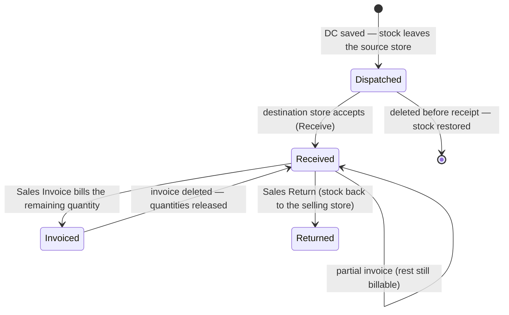
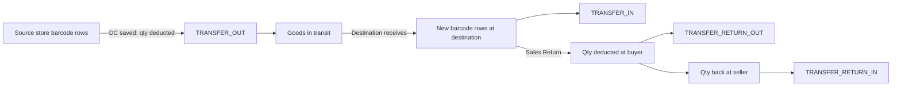

# Inter Store Sell — Implementation & Flow Guide

**Last updated: 31 October 2026**

> Scope: the sidebar rename of **Inter Company Sell**, the new **Inter Store Sell** module
> (Delivery Challan, Sales Invoice, Received Debit Note, Sales Return), its GST rules,
> stock movement, permissions, APIs and current verification state.
>
> **Status:** implemented and code-verified (syntax + import checks). A production
> `next build` has **not** been completed on this machine — the drive is 100 % full and
> Next aborts with `ENOSPC`. See [Verification](#12-verification--known-limitations).

---

## 1. What changed

### 1.1 Sidebar labels (Inter Company Sell)

| Before | After | Route |
|---|---|---|
| Consignment | **Consignment Given** | `/admin/transaction/intercompanysell/deliverychallan` |
| Receive Delivery Challan | **Consignment Receive** | `/admin/transaction/intercompanysell/receivedeliverychallan` |
| Sales Invoice | Sales Invoice | `/admin/transaction/intercompanysell/sales-invoice` |
| Auto Purchases Receiveds | **Auto Purchases Received** | `/admin/transaction/intercompanysell/auto-purchase-receiveds` |
| Return Approval | Return Approval | `/admin/transaction/intercompanysell/consignment` |

Labels only. Hrefs, icons, permission keys and every workflow are unchanged, so existing
bookmarks and saved permission matrices still resolve.

### 1.2 New sidebar group

`INTER STORE SELL` sits **immediately above MAIN REPORTS**:

```
INTER COMPANY SELL
  Consignment Given
  Consignment Receive
  Sales Invoice
  Auto Purchases Received
  Return Approval

INTER STORE SELL
  Delivery Challan
  Sales Invoice
  Received Debit Note
  Sales Return

MAIN REPORTS
```

Routes live under `/admin/transaction/interstoresell/…`.

---

## 2. The business difference

| | Inter Company Sell | Inter Store Sell |
|---|---|---|
| Parties | Two **businesses** | Two **stores (locations)** of the same business |
| GST | **Not applied** (unchanged) | **Applied** on every document |
| Tax source | — | HSN Master → Tax Master, resolved on the server |
| Collections | `icdeliverychallan`, `icsalesinvoice`, … | `storedeliverychallan`, `storesalesinvoice`, `storedebitnote`, `storesalesreturn` |
| Discriminator | — | `module: 'interStoreSell'` stamped and filtered |

Nothing in the Inter Company flow was changed apart from the two labels; its no-GST
behaviour and history are untouched.

---

## 3. Document lifecycle



| Document | Created by | Stock effect | Can be deleted |
|---|---|---|---|
| Delivery Challan | Selling store | **Out** of the source store on save; **into** the destination on Receive | Only before receipt and before invoicing (stock restored) |
| Sales Invoice | Selling store | None | Yes, if no debit note or return references it (claims released) |
| Received Debit Note | Buying store | **None** — financial adjustment only | Yes (adjustment reversed) |
| Sales Return | Buying store | **Back** from the buying store into the selling store | No — it has moved stock |

---

## 4. Flow: Delivery Challan

1. Selling store opens **Inter Store Sell → Delivery Challan → Add**.
2. Picks the **Destination Store** (source store comes from the top bar) and a date.
3. Scans a barcode → `GET /api/is-delivery-challan/item-lookup` returns item, HSN, UOM,
   rate, available quantity **at that store**, and the GST % resolved for that value.
4. Sets quantity / rate / discount. Totals preview with CGST + SGST (or IGST).
5. **Save** → `POST /api/is-delivery-challan`:
   - re-resolves GST per line from the HSN/Tax master (request percentages are ignored),
   - recomputes every amount and the document totals,
   - allocates `ISDC/0001` atomically (per store per financial year),
   - saves, then ships the stock; if shipping fails the document is removed again.
6. The goods are **in transit**: the source stock is down, the destination stock does not
   exist yet.
7. The **destination store** opens the same screen and uses the
   **“Awaiting Receipt at This Store”** panel → **Receive** →
   `POST /api/is-delivery-challan/<id>/receive`:
   - creates barcode rows at the destination (idempotent),
   - writes `TRANSFER_IN` movements,
   - stamps `receivedAt` / `receivedBy`, status → `received`.
8. Print from the list’s print action.

**Editing:** remarks and stock point only, and only while unreceived/uninvoiced.
Quantities are fixed because the stock ledger already records them — delete an unreceived
challan (stock restored) and re-raise for a correction.

---

## 5. Flow: Sales Invoice

1. Selling store → **Sales Invoice → Add**.
2. Chooses a **received** challan. The form loads that challan’s **saved** lines with each
   line’s remaining unbilled quantity.
3. Quantities may be reduced (partial invoicing). Only lines with a quantity are sent.
4. **Save** → `POST /api/is-sales-invoice`:
   - loads the challans (same business + selling store) and refuses an unreceived one,
   - copies the lines from the stored document (never from the payload),
   - caps each line at `qty − billedQty` and refuses more,
   - recomputes totals and GST, allocates `ISSI/0001`,
   - claims each challan line with a **compare-and-set** on the billed quantity; if another
     request billed it first, the invoice is removed and the request refused,
   - marks the challan `invoiced` only when nothing is left unbilled.
5. Print from the list.

Deleting the invoice releases the claimed quantities so the units can be billed again.

---

## 6. Flow: Received Debit Note

Raised by the **buying store** against an invoice addressed to it.

1. **Received Debit Note → Add** → choose the invoice → lines load with the adjustable
   quantity (`qty − debitedQty − returnedQty`).
2. Enter quantities and a reason, Save.
3. `POST /api/is-debit-note` recomputes the value/GST, allocates `ISDN/0001`, and increments
   `debitedQty` with a compare-and-set.
4. **No stock moves and no barcode row is created.** A damaged-goods return is a Sales
   Return, not a debit note.

Deleting the note gives the adjusted quantity back to the invoice line.

---

## 7. Flow: Sales Return

Also raised by the **buying store**, and the only post-challan document that moves stock.

1. **Sales Return → Add** → choose the invoice → enter return quantities
   (capped at `qty − returnedQty − debitedQty`).
2. `POST /api/is-sales-return`:
   - allocates `ISRT/0001`,
   - claims `returnedQty` first (compare-and-set), so a retry cannot pass the cap,
   - moves stock: quantity **out** of the buying store’s rows for that challan and **back**
     into the selling store (recreating a row if none is left),
   - writes `TRANSFER_RETURN_OUT` and `TRANSFER_RETURN_IN` movements.
3. If the stock movement fails, the claim and the document are undone — a saved return
   always corresponds to stock that actually moved.

A confirmed return cannot be deleted; raise the opposite transaction.

---

## 8. Stock movement



- Quantity-based: one barcode can be spread across several rows, and a row holding 33 can
  ship 5 and keep 28. Each line records the rows it came off (`stockMoves`).
- Every write is guarded (`qtyNum >= take`), so a concurrent request cannot overdraw.
- Receipt is **idempotent**: destination rows carry `storeChallanId` + `sourceBarcodeId`.
- No double deduction, no duplicate barcode rows, full `stockMovement` audit trail.

---

## 9. GST

- **Rate** comes from the HSN Master: HSN → the slab whose Amount From/To band contains the
  line value → the Tax record it points at. The percentage in the request is ignored.
- **Split**: CGST + SGST when the two stores share a state (or no state is recorded);
  IGST when they record different states, or when the tax row is IGST-only.
  IGST is the whole rate; CGST/SGST are halves with the rounding remainder on SGST.
- **Totals**: `Before Tax = (Rate − Discount − R.Off Discount) × Qty`,
  `Net = Before Tax + GST`, then a whole-rupee **Round Off**.
- Missing HSN/slab ⇒ **0 %**, never an invented rate. Complete the HSN Master first.
- Example (validation only): taxable ₹10,000 at 5 % → CGST ₹250 + SGST ₹250 → ₹10,500.

---

## 10. API reference

All endpoints require a session and are gated by the screen permission matrix.
List responses share the shape `{ rows, labels, summary, total, page, pages, perPage }`.

| Method | Endpoint | Purpose |
|---|---|---|
| GET | `/api/is-delivery-challan` | List (business, location, `toLocationId`, `finYear`, `status`, dates, search) |
| POST | `/api/is-delivery-challan` | Create + ship stock |
| GET | `/api/is-delivery-challan/[id]` | Read one |
| PUT | `/api/is-delivery-challan/[id]` | Edit remarks / stock point (unreceived, uninvoiced only) |
| DELETE | `/api/is-delivery-challan/[id]` | Delete before receipt (restores stock) |
| POST | `/api/is-delivery-challan/[id]/receive` | Destination receipt (idempotent) |
| GET | `/api/is-delivery-challan/item-lookup` | Barcode → item, HSN, UOM, stock at the store, GST % |
| GET | `/api/is-sales-invoice` | List |
| POST | `/api/is-sales-invoice` | Bill challan lines (`deliveryChallanIds` + optional `lines`) |
| GET | `/api/is-sales-invoice/[id]` | Read one |
| DELETE | `/api/is-sales-invoice/[id]` | Delete and release the challan quantities |
| GET | `/api/is-debit-note` | List |
| POST | `/api/is-debit-note` | Create (financial only, no stock) |
| GET | `/api/is-debit-note/[id]` | Read one |
| DELETE | `/api/is-debit-note/[id]` | Delete and reverse the adjustment |
| GET | `/api/is-sales-return` | List |
| POST | `/api/is-sales-return` | Create + move stock back |
| GET | `/api/is-sales-return/[id]` | Read one |
| DELETE | `/api/is-sales-return/[id]` | Always refused (409) — stock has moved |

---

## 11. Files

**Sidebar / permissions**
- `config/nav.js` — renamed Inter Company labels; new Inter Store Sell group above Main Reports
- `lib/screenPermission.js` — four `IS_*` screens; lookup-screen lists
- `app/admin/staff-management/roles-permissions/fields.js` — seeded group rules

**Models**
- `models/StoreDeliveryChallan.js`, `models/StoreSalesInvoice.js`,
  `models/StoreDebitNote.js`, `models/StoreSalesReturn.js`

**Libraries**
- `lib/storeSell.js` — shared line/GST maths (browser + server)
- `lib/storeGst.js` — HSN → slab → tax resolution, CGST/SGST vs IGST
- `lib/storeStock.js` — ship, receive, return, restore; movement ledger
- `lib/storeDocList.js` — the shared list endpoint

**API**: `app/api/is-delivery-challan/**`, `is-sales-invoice/**`, `is-debit-note/**`,
`is-sales-return/**`

**Screens**
- `app/admin/transaction/interstoresell/deliverychallan/{page.jsx, add, [id], print/[id]}`
- `…/salesinvoice/{page.jsx, add, print/[id]}`
- `…/receiveddebitnote/{page.jsx, add, print/[id]}`
- `…/salesreturn/{page.jsx, add, print/[id]}`
- `components/StoreSellDocForm.jsx` — one creation form, four modes
- `components/StoreReceivePanel.jsx` — destination receipt panel
- `components/StoreDocPrintView.jsx` — print view for all four documents

---

## 12. Verification & known limitations

**Run on 31-10-2026**
- JSX-aware parse of **37** new/changed files — **OK**
- Every `@/…` alias and relative import resolves — **OK**
- No zero-byte or truncated files in the module — **OK**
- `npm run build` — **NOT completed**: the drive is 100 % full; Next aborts with `ENOSPC`
  even after clearing 919 MB of regenerable cache. No lint, runtime or MongoDB test has run.

**Known limitations**
- Not build-tested and not exercised against a database; do both before deployment.
- No draft lifecycle — documents are confirmed on save.
- Document lines cannot be edited after saving; delete/re-raise instead.
- A confirmed Sales Return cannot be deleted.
- Status filter exists only where status is meaningful (Delivery Challan).
- Financial-year and source-store filtering follow the top-bar scope; the
  destination-store filter is explicit.
- IGST depends on `CompanyLocation.state` being filled for both stores.
- GST is only as correct as the HSN/Tax masters; an unmatched HSN yields 0 %.

**To close verification**

```bash
# free several GB first (build caches / extracted archives), then:
npm run build
```

Then walk one chain end to end: challan → receive → invoice → debit note → sales return,
checking stock at both stores and the `stockMovement` ledger after each step.
